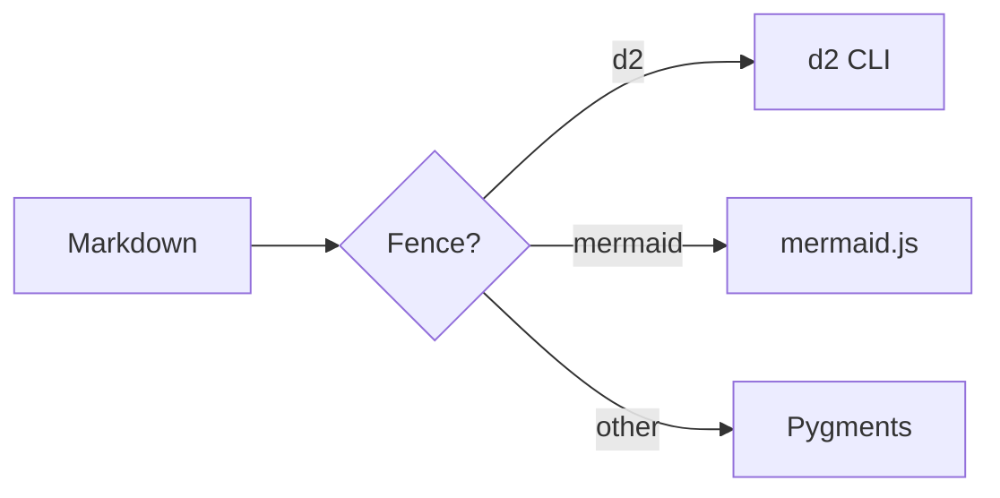

# Wildcat Markdown Viewer — feature tour :wave:

A quick tour of everything this viewer renders. Edit this file while it is open — the view
live-reloads on save.

## Text formatting

**Bold**, *italic*, ***both***, ~~strikethrough~~, `inline code`, <kbd>Ctrl</kbd>+<kbd>O</kbd>,
H<sub>2</sub>O and E = mc<sup>2</sup>. Autolinks: https://github.com and www.example.com.
Emoji shortcodes :rocket: :tada: :+1:.

> A plain blockquote.
>
> > Nested.

## Alerts

> [!NOTE]
> Useful information that users should know, even when skimming content.

> [!TIP]
> Helpful advice for doing things better or more easily.

> [!IMPORTANT]
> Key information users need to know to achieve their goal.

> [!WARNING]
> Urgent info that needs immediate user attention to avoid problems.

> [!CAUTION]
> Advises about risks or negative outcomes of certain actions.

## Lists

1. First
2. Second
   - nested bullet
   - another
     1. deeper
3. Third

- [x] Write the viewer
- [x] Add D2 support
- [ ] Ship it

## Table

| Feature        | Status | Notes                    |
| :------------- | :----: | -----------------------: |
| GFM tables     | ✅     | alignment works          |
| Syntax colours | ✅     | via Pygments             |
| D2 diagrams    | ✅     | rendered by the d2 CLI   |

## Code

```python
from dataclasses import dataclass

@dataclass
class Point:
    x: float
    y: float

    def norm(self) -> float:
        return (self.x ** 2 + self.y ** 2) ** 0.5
```

```rust
fn main() {
    let v: Vec<u32> = (1..=10).filter(|n| n % 2 == 0).collect();
    println!("{v:?}");
}
```

```diff
- old line
+ new line
```

## D2 diagrams

```d2
direction: right
user: User {shape: person}
app: Wildcat Viewer {
  renderer: markdown-it
  d2: d2 CLI
  webview: WebView2
}
file: README.md {shape: page}

user -> app.webview: views
app.renderer -> app.d2: ```d2 fences
file -> app.renderer: reads
app.d2 -> app.webview: SVG
```

Fence options (an extension of this viewer): `sketch`, `layout=elk`, `theme=<id>`, `pad=<px>`, `center`.

```d2 sketch
shape: sequence_diagram
alice -> bob: Hello
bob -> alice: Hi there!
```

## Mermaid



## Math

Inline math $e^{i\pi} + 1 = 0$ and display math:

$$
\int_{-\infty}^{\infty} e^{-x^2}\,dx = \sqrt{\pi}
$$

```math
\begin{bmatrix} a & b \\ c & d \end{bmatrix}^{-1} = \frac{1}{ad-bc}\begin{bmatrix} d & -b \\ -c & a \end{bmatrix}
```

## Footnotes

Here is a footnote reference[^note] and another[^2].

[^note]: The footnote text.
[^2]: A second footnote.

## HTML

<details>
<summary>Click to expand</summary>

Hidden content with **markdown** inside.

</details>

<p align="center">Centered paragraph via raw HTML.</p>

## Links

- [Jump to Alerts](#alerts)
- [External link](https://d2lang.com)

---

*The end.*
